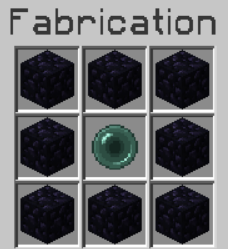

# 💀 Mode Hardcore

> Ici, une mort te coûte cher : tu es banni quelques heures, mais chaque kill te rapporte des points. Cette page t'explique comment survivre, traquer et grimper au classement.

## ⚡ En bref

- Le monde fait **5000 × 5000 blocs** (le Nether **1000 × 1000**). Impossible d'aller au-delà de la bordure.
- À ta **première connexion** et après **chaque mort**, tu es téléporté au hasard dans le monde, avec **5 steaks cuits** et une **Boussole traqueuse**.
- Si tu **meurs**, tu es **banni temporairement** (12 h par défaut) et tu perds ton inventaire.
- Tuer un joueur te donne **+1 kill**, **Vitesse III pendant 1 minute**, sa **tête**, et une chance de gagner une **Émeraude magique**.
- Chaque kill place une **prime d'une heure** sur ta tête.
- Ton score dépend de tes kills, de tes morts et de ton temps de jeu : il alimente le **Top 10**.

## 🗺️ Le monde

| Zone | Taille | Particularités |
|---|---|---|
| Overworld | 5000 × 5000 | Bordure infranchissable |
| Nether | 1000 × 1000 | Accessible avec un Ticket du Nether |
| WarZone (spawn) | environ 100 × 100 autour du centre | Zone protégée |

Quand tu touches la bordure, tu reçois : *« Tu ne peux pas aller au-delà des limites de la map ! »* et tu es repoussé.

### 🛡️ La WarZone

C'est la zone centrale du monde. Quand tu y entres, tu vois *« Vous êtes entré dans la WarZone. »*, et en sortant *« Vous êtes entré dans la Wilderness. »*.

Dans la WarZone :

- tu ne peux **ni casser ni poser de blocs** ;
- les **explosions** ne détruisent rien ;
- l'**eau**, la **lave**, les **pistons** et les **seaux** n'altèrent pas le terrain ;
- les **cadres**, **peintures**, **chariots** et **bateaux** sont protégés ;
- la terre labourée ne se piétine pas ;
- tu ne subis **aucun dégât de chute**.


Les **perles de l'Ender** sont interdites dans la WarZone : *« Les perles de l'Ender sont interdites dans cette zone. »* La perle te est rendue.


## 🎲 Apparition aléatoire

Tu n'apparais jamais au même endroit. Le jeu te place sur un sol sûr de la surface, en dehors de la WarZone et loin des océans et des rivières.

Tu reçois à chaque apparition :

- 5 steaks cuits ;
- une **Boussole traqueuse** (voir [La traque](traque.md)).

## 🔥 Le Nether

Les portails classiques sont **désactivés**. Pour aller dans le Nether, il te faut un **Ticket du Nether**.

### Recette

Entoure **1 perle de l'Ender** de **8 obsidiennes** : tu obtiens **2 tickets**.

### Traversée

1. Fais un **clic droit** avec le ticket.
2. Un **compte à rebours de 5 secondes** démarre. Tu dois rester **immobile** et tu ressens de la nausée.
3. Tu arrives à un **endroit aléatoire** de l'autre monde. Un message annonce à tout le monde : *« <joueur> vient d'entrer dans le Nether. »* (ou *« vient de quitter le Nether. »*).


Le ticket n'est consommé que si la traversée réussit. Si elle est annulée, il t'est rendu.


La traversée est **annulée** si tu bouges (*« Traversée annulée ! Vous avez bougé. »*) ou si tu es en combat (*« Traversée annulée ! Vous êtes en combat. »*).

Elle est **refusée** :

- en combat : *« Impossible de traverser en combat. »* ;
- depuis l'Overworld pendant que la boussole traque : *« Impossible de traverser pendant la track. »* (tu peux en revanche sortir du Nether).

### 🍄 Verrue du Nether

Toutes les 20 minutes, chaque joueur présent dans le Nether reçoit **1 verrue du Nether** : *« Vous venez de recevoir x1 verrue du Nether. (Prochaine dans 20 minutes) »*.

## 📚 Pour aller plus loin

- [⚔️ Combat, mort et primes](combat.md) : bannissement, cooldowns, équipement, primes
- [🧭 La traque](traque.md) : boussole, Émeraude magique, classement
- [📦 Coffres à loot](loot.md) : butin et annonces

Pour les commandes et règles communes à tous les modes (maisons, chat, combat-log…), consulte [les commandes](../general/commandes.md) et [le règlement](../general/regles.md).

## ⌨️ Commandes

| Commande | Effet | Qui peut l'utiliser |
|---|---|---|
| `/prime` | Liste les joueurs recherchés | Tous |
| `/classement` | Affiche le Top 10 | Tous |
| `/stats [joueur]` | Affiche les statistiques | Tous |
| `/playtime` | Affiche ton temps de jeu | Tous |

Le détail de chaque commande se trouve sur les pages ci-dessus.
